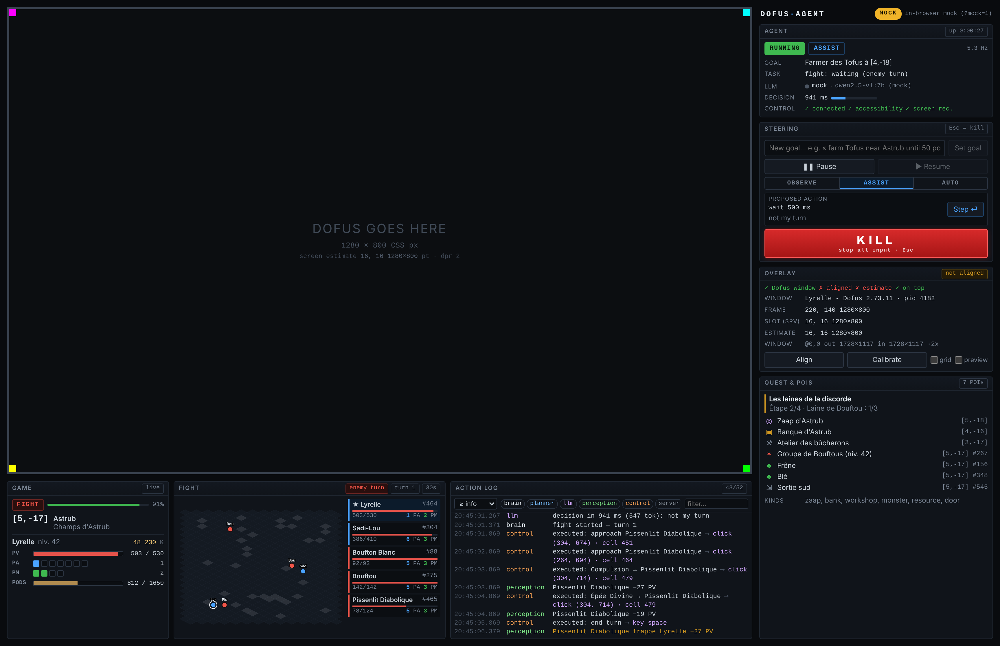

# dofus-agent · webapp

The dashboard for the Dofus agent. It shows the agent's state and lets you steer it. It also keeps a fixed, empty **slot** where `control/` places the real Dofus window. The page only talks over WebSocket (`shared/protocol.md` §2). It includes an in-browser mock backend, so it runs on its own.



## Run

```bash
cd webapp
npm install
npm run dev        # http://localhost:5173 (strictPort)
npm test           # vitest: slot geometry, grid, link/ack/fallback, store, params
npm run build      # tsc + vite build → dist/
node scripts/e2e.cjs   # optional Playwright smoke test against the running dev server (writes docs/screenshot.png)
```

Open `http://localhost:5173/?mock=1` to try it without a backend.

## URL parameters

| param | default | meaning |
|---|---|---|
| `ws` | `ws://127.0.0.1:8765/ws` | backend WebSocket URL |
| `mock` | off | `mock=1` forces the in-browser mock backend |
| `slot` | `1280x800` | slot size in CSS px (`WxH`, each side 320–4096) |
| `grid` | off | `grid=1` starts with the 560-cell calibration grid overlay shown |
| `zoom` | `1` | `zoom_hint` sent in `slot.report` (only set it if you really run at a non-100% zoom) |

**Mock fallback.** If the real backend can't be reached for 3 s, the page switches to the mock and shows an amber **MOCK** badge. It keeps retrying the real backend with exponential backoff (0.5 s → 10 s). When the real backend answers, the page switches back and drops the mock data. The mock cycles between world, fight and dialog about every 20 s, and it responds to every steering message.

## Layout

- The slot's top-left is fixed at **(16, 16)** viewport CSS px: a 12 px margin plus the 4 px border. Its size comes from `?slot`. It is `position: fixed`, and nothing in the page can move or resize it. The page never scrolls; each panel scrolls on its own.
- The 4 px border is a CSS `outline`, so it sits **outside** the rect and doesn't change `getBoundingClientRect()`. The corner markers are 12×12 px squares inside the corners: `#FF00FF` TL, `#00FFFF` TR, `#FFFF00` BL, `#00FF00` BR (§3). The slot background is a flat neutral dark, so any misalignment of the Dofus window shows up clearly.
- The right sidebar holds connection, Agent, Steering, Overlay, and Quest & POIs. The bottom strip under the slot holds Game, Fight/Dialog/Map and the Action log. With the default slot, everything fits in 1728×1117 (MacBook Pro 16") and still works down to about 1728×1050.
- Keyboard: **Esc** sends `steer.kill` whenever the page has focus.

## Slot reporting

`src/slot.ts` holds pure functions with unit tests in `src/slot.test.ts`. `src/useSlotReporter.ts` calls them and sends `slot.report` (with no `id`, so no ack is expected):

- when the page connects or reconnects (including a switch between mock and real),
- on `resize` and from a `ResizeObserver` on the slot,
- every 2 s,
- as soon as `window.screenX/screenY` change. These are polled every 250 ms, because browsers have no "window moved" event.

The report contains `rect_css` (from `getBoundingClientRect`), `window` (`screenX/Y`, outer and inner sizes), `devicePixelRatio`, `zoom_hint`, and `estimate_screen`:

```
screen_x = screenX + (outerWidth  - innerWidth )/2 + rect.x
screen_y = screenY + (outerHeight - innerHeight)   + rect.y
w, h     = rect.w, rect.h
```

The zoom factor applies only to the CSS-px terms (`inner*`, `rect`). `screenX/Y` and `outer*` are already in screen points. With zoom 1, this is exactly the §3 formula. The estimate appears in the Overlay panel and inside the empty slot. The Overlay panel also shows the slot rect the server is actually using, and flags it when it differs from the page's estimate.

## Recommended browser setup for a precise overlay

The estimate is only exact when the browser adds no chrome on the left, right or bottom, and when its zoom is 100%. The calibrated slot (**Calibrate** button, §3 markers) is always exact; use it after any change.

1. Use Chrome (or Chromium/Brave/Edge) in **app mode**, which gives a window with no tabs or toolbar:
   ```bash
   open -na "Google Chrome" --args --app="http://localhost:5173/" --window-position=0,0 --window-size=1728,1117
   ```
2. Keep the page zoom at **100%** (⌘0). Don't use `?zoom` unless you really zoom.
3. Put that window in **full screen** (⌃⌘F or the green button). The inner size then matches the screen, and the estimate equals the slot's real position. On a notched MacBook, the full-screen content starts below the menu-bar area. `screenY` reflects that, so the estimate stays correct.
4. Leave the Dofus client at its normal scale. `control/` resizes its content area to match the slot (1280×800 points by default).
5. Click **Align**. Then, if precision matters, click **Calibrate**. The Overlay panel should show `aligned` and `calibrated`.

The **grid** checkbox draws an approximate 560-cell iso grid (14×40, odd rows shifted) over the slot, for a quick visual check. It is fitted to the slot minus about 11.5% for the HUD. It is not the calibration in `brain/config/grid.json`.

## Code map

```
src/
  protocol.ts          §2.3 types + message envelopes (mirrors shared/protocol.md)
  slot.ts / .test.ts   slot constants, ?slot parsing, SlotReport + §3 estimate (pure)
  grid.ts / .test.ts   560-cell iso geometry (§1)
  link.ts / .test.ts   WebSocket client: backoff, request ids + ack promises, mock fallback
  store.ts / .test.ts  reducer for server messages
  params.ts / .test.ts URL params
  useSlotReporter.ts   sends slot.report
  mock/mockBackend.ts  in-browser mock of dofus-brain
  mock/preview.ts      fake frame.preview JPEG
  components/          Slot, Header, Agent/Steering/Overlay/Game/World/Scene/Log panels, Toasts
scripts/e2e.cjs        Playwright smoke test (no-scroll, slot rect, markers, steering, screenshot)
```

For debugging, open the devtools console and run `window.__dofus.request("steer.mode", { mode: "auto" })`. It sends any request and shows a toast if it fails.
